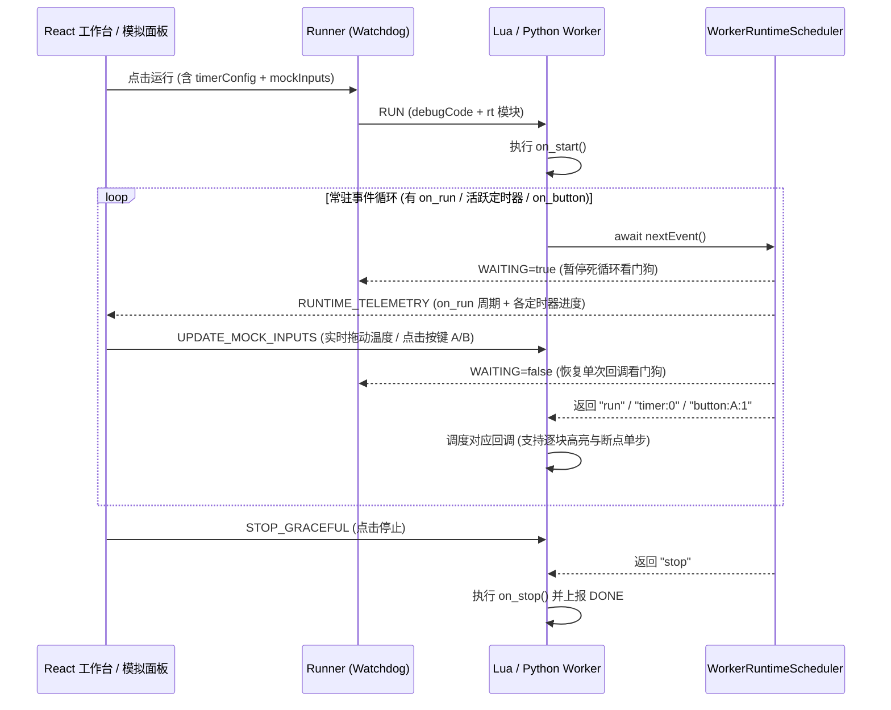
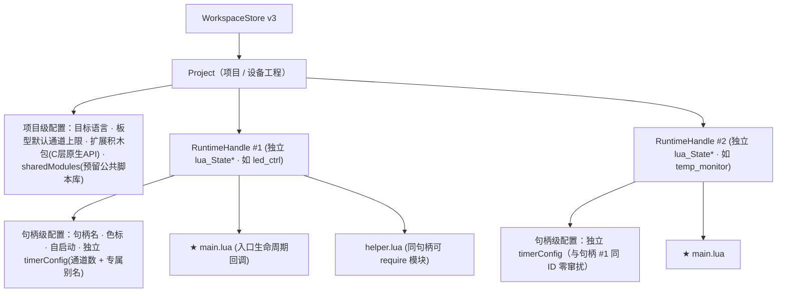

# PolyBlock 系统架构与工程方案（Phase 1）

## 1. 分层架构总览

```text
+------------------------------------------------------------------------------+
|                       UI 表现层 (React 19 + TypeScript)                       |
|  [TopBar] [ActivityRail (#/hash)] [BlocklyWorkspace] [CodePane] [LogConsole] |
+---------------------------------------+--------------------------------------+
                                        | Blockly JSON / 编辑与选中事件
                                        v
+------------------------------------------------------------------------------+
|                        核心编排层 (src/core/blocks)                           |
|  - MicroZelosRenderer (紧凑圆角/榫口) + Light/Dark Theme                       |
|  - 积木目录与搜索元数据 (9 分类含独立打印日志模块 + Plus/Minus 变参)              |
|  - 静态诊断器 (悬空积木、空入口提示)                                           |
+---------------------------------------+--------------------------------------+
                                        | workspace
                                        v
+------------------------------------------------------------------------------+
|                     多语言后端适配层 (src/core/backends)                       |
|  BackendRegistry (统一 ScriptBackendAdapter 契约)                             |
|    ├── LuaBackendAdapter    (Lua 5.4 代码生成 + Sentinel SourceMap 提取)      |
|    └── PythonBackendAdapter (Python 3 代码生成 + Sentinel SourceMap 提取)     |
+---------------------------------------+--------------------------------------+
                                        | { code, sourceMap, language }
                                        v
+------------------------------------------------------------------------------+
|                     可插拔执行器层 (src/core/runners)                         |
|  RunnerManager (统一 ScriptRunner 契约: run / stop / onLog / onStatusChange)  |
|    ├── WasmoonLuaRunner       -> Web Worker (wasmoon Lua 5.4 WASM)           |
|    ├── MicroPythonWasmRunner  -> Web Worker (MicroPython WASM)               |
|    └── [预留插件槽位]          -> RemoteWsRunner / LocalBridgeRunner / Serial  |
+------------------------------------------------------------------------------+
```

## 2. 关键数据流与交互闭环

```text
用户拖拽积木 ──> Blockly Change Event (防抖)
                    │
                    ├──> 持久化到 localStorage (防止刷新丢失)
                    └──> Active BackendAdapter.generate(workspace)
                            │
                            ├──> 剥离内部行号哨兵，生成干净的 main.lua / main.py
                            ├──> 构建 SourceMap: blockId <-> [startLine, endLine]
                            └──> 刷新右侧代码区 & 诊断数量

用户点击 [▶ 运行] ──> RunnerManager.run({ language, code, timeoutMs })
                        │
                        ├──> 启动/复用对应 Web Worker (隔离主线程)
                        ├──> 实时截获 print / stdout / stderr ──> 底部日志控制台
                        ├──> 若发生语法/运行错误，解析行号反查 SourceMap ──> 画布高亮出错积木
                        └──> 点击 [■ 停止] 或超时 ──> worker.terminate() 立即终止并安全重建
```

## 3. 核心契约设计

### 3.1 `ScriptBackendAdapter`（扩展新脚本语言只需实现此接口）
- `id: 'lua' | 'python' | string`
- `name: string`、`version: string`、`extension: string`、`fileName: string`
- `generate(workspace: Blockly.Workspace): GeneratedCodeResult`
  - 返回：`code`（纯洁可独立运行脚本）、`sourceMap`（`Record<string, LineRange>`）、`diagnostics`、`blockCount`

### 3.2 `ScriptRunner`（可插拔执行器契约）
- `id: string`、`name: string`、`kind: 'browser-wasm' | 'network' | 'serial' | 'bridge'`
- `supportedLanguages: ScriptLanguageId[]`
- `run(request: RunRequest, callbacks: RunCallbacks): Promise<RunResult>`
- `stop(): void`
- `dispose(): void`

## 4. GitHub Pages 静态部署约束
1. Vite 配置 `base: './'`，确保部署在 `https://<user>.github.io/<repo>/` 子路径时所有 JS/CSS/WASM/Worker 相对寻址正确。
2. `wasmoon` 的 `glue.wasm` 与 `@micropython/micropython-webassembly-pyscript` 的 `.wasm` 均由 Vite 本地打包为静态资产（`?url`），零外部 CDN 依赖。
3. 路由使用状态 + `window.location.hash`（`#/blocks`、`#/projects`、`#/devices`、`#/extensions`、`#/settings`），刷新不出现 404。
4. 不使用 `SharedArrayBuffer`，完全兼容 GitHub Pages 默认 HTTP 响应头。
5. 提供 `.github/workflows/deploy.yml` 自动化构建与发布 GitHub Pages。

## 5. Phase 2 扩展：双代码产线与异步沙箱调试架构

为同时兼顾“浏览器沙箱强调试”与“未来真机板子下发纯净脚本”，后端代码生成与沙箱执行升级为双产线设计：

```text
[Blockly Workspace]
   ├──> cleanCode (100% 纯净标准 Lua / Python)
   │       ├── 右侧代码区展示 & 一键导出 (.lua / .py)
   │       └── 未来直接下载至目标硬件板子（零调试插桩）
   │
   └──> debugCode (仅沙箱运行态，含异步追踪桩 + 非阻塞延时)
           ├── Lua 5.4: __poly_step(blockId, snap):await() / __poly_sleep(ms):await()
           └── Python 3: await _poly.step(blockId, snap) / await _poly.sleep(ms)
                               │
                               ▼ (Web Worker 双向消息，零 SharedArrayBuffer)
                    STEP / PAUSED / WAITING / RESUME / STEP_NEXT / SET_BREAKPOINTS
                               │
                               ▼
              [画布执行块发光] + [代码行同步高亮 & 断点槽] + [实时变量监视]
```

### 关键保障
- **延时积木（`poly_wait_ms`）**：干净导出时生成标准等待代码（Python `time.sleep(...)`、Lua 独立 `poly_wait_ms` 辅助函数）；沙箱运行时走非阻塞 `setTimeout` Promise。
- **超时保护不误杀**：Worker 处于断点暂停（`PAUSED`）或显式等待（`WAITING`）期间自动暂停看门狗计时，仅对真实计算死循环触发超时强杀；点击「停止」仍可随时立即终止 Worker。

## 6. Phase 3 升级：v2 以项目为根的多脚本工程模型

将底层数据模型从“单项目 = 单画布”重构为三层项目树结构（1A 项目级统一目标语言 + 2A 运行当前激活标签脚本）：

```text
WorkspaceStore (localStorage: polyblock.store.v2，自动兼容迁移 v1 数据)
 └── ProjectModel (项目根容器)
      ├── id, name, description, language ('lua' | 'python')
      ├── enabledExtensions: string[]   (项目级扩展挂载点)
      ├── entryScriptId: string         (标星 ★ 入口脚本)
      ├── activeScriptId: string        (当前激活画布标签)
      └── scripts: ProjectScript[]      (1..N 个独立积木编程脚本)
           ├── id, name                 (如 main / step_debug / threshold_alarm)
           ├── workspace                (独立 Blockly JSON 状态)
           └── breakpoints[]            (独立断点列表)
```

### 交互与隔离约束
1. **顶栏以项目为根**：左上角提供项目切换器下拉菜单（切项目、新建、重命名、保存整项目工程）。
2. **画布顶部 36px 脚本标签栏**：与右侧 `CodeInspector` 顶栏齐平，支持单击切换画布、`+` 新建脚本、双击行内重命名、复制、设为入口（★）、删除以及多脚本快速下拉跳转，不占用画布横向宽度。
3. **严格状态隔离**：切换脚本标签前先立即快照保存当前画布，切换时禁用 Blockly 临时事件并清空撤销栈（`clearUndo`），确保不同脚本的积木、撤销历史、断点与生成代码互不串台。

## 7. Phase 4 扩展：声明式积木扩展包与沙箱虚拟外设模拟架构

通过统一 `PolyExtensionPack` JSON 规范，在不修改核心代码的前提下动态扩展新积木分类、双语言代码模板与浏览器沙箱 Mock 模块：

```text
[PolyExtensionPack (.polyext.json)]
   ├── 元信息: id / name / version / categoryLabel / color
   ├── 积木定义: blocks[] (外观 JSON + 默认 shadow + 搜索词)
   ├── 多语言生成模板: lua { template, imports } / python { template, imports }
   └── 可选沙箱 Mock: sandboxMock { moduleName, luaSource, pythonSource }
                 │
                 ├──> ExtensionRegistry.register() ──> 动态注入 Blockly 积木 + Lua/Python 生成器
                 ├──> ProjectModel.enabledExtensions[] ──> 按项目动态呈现左侧积木分类与搜索
                 └──> Worker Runner (package.preload / sys.modules) ──> 实时 DEVICE_EVENT 回传虚拟外设面板
```

### 关键收益
- **一份扩展包通吃“沙箱模拟 + 真机导出”**：导出给目标板子的仍是标准 `local board = require("board")` / `import board` 纯净代码；浏览器沙箱自动挂载 `sandboxMock` 并驱动交互式虚拟外设面板（LED / RGB / OLED / 模拟温度滑块 / 按键 A·B）。
- **支持外部自定义扩展包导入**：用户在「扩展」页可一键下载 JSON 模板、导入自定义 `.polyext.json` 积木包（持久化于 `polyblock.extensions.custom.v1`）并按项目随时启停。


## 8. 事件驱动生命周期、多路编号定时器与硬件事件回调架构（Phase 5）

为让沙箱仿真完整对齐真实嵌入式 Lua/Python 固件（特别是多隔离 `lua_State*` 句柄场景），Phase 5 引入零闭包、纯整数通道 ID 的顶层事件分发 ABI 与协作式 WASM 事件循环：

### 8.1 顶层零闭包导出协议（Board-Ready ABI）
- **设计约束**：不在 C 层维护 `luaL_ref` 回调闭包表；所有事件回调均导出为顶层标准函数，嵌入式 C 宿主仅需 `lua_getglobal(L, "on_timer")` + `lua_pushinteger(L, id)` + `lua_pcall` 即可安全派发，多隔离 `lua_State*` 句柄天然互不窜扰。
- **生命周期与事件入口**：
  - `on_start()`：启动后执行一次初始化；
  - `on_run()`：周期主回调（默认 `100ms`，可通过 `rt.set_run_period(ms)` / `rt.start_run()` / `rt.stop_run()` 控制）；
  - `on_timer(id)`：由代码生成器自动将画布上多个 `当定时器 [Ti] 触发时` 帽子积木聚合为单一 `if id == 0 ... elseif id == 1 ...` 分发函数；
  - `on_button(key, pressed)`：聚合虚拟板卡 `当按键 [A/B] [按下/释放] 时` 回调；
  - `on_stop()`：手动停止时优雅触发安全收尾。
- **精简 `rt` 运行时 API**（Lua 顶部导出 `local rt = require("rt")`，Python 顶部导出 `import rt`）：
  - `rt.set_run_period(ms)` / `rt.start_run()` / `rt.stop_run()`
  - `rt.start_timer(id, period_ms, repeat)`：`repeat = 0` 表示持续循环，`1` 表示单次触发，`N > 1` 表示触发 `N` 次后自动停止；对运行中通道再次调用按嵌入式惯例重置倒计时（re-arm）。
  - `rt.stop_timer(id)`：停止指定通道。
  - `rt.get_timer_value(id)`：返回本周期已流逝毫秒数（`0 -> period_ms`，未运行返回 `0`）。
  - `rt.is_timer_running(id)`：返回通道是否处于运行态（布尔值）。

### 8.2 项目级定时器能力配置（`ProjectTimerConfig`）
- `ProjectModel.timerConfig` 记录当前目标板/项目支持的定时器通道数 `count`（默认 `8`，可配置范围 `1 ~ 32`，对应 ID `0 ~ count-1`）及可选通道别名 `aliases`（如 `"0": "心跳灯"`）。
- 积木下拉框自动展示 `T0 · 心跳灯`，但生成代码始终输出纯整数 ID（`0`），兼顾可读性与嵌入式零字符串开销。
- 静态诊断自动检测重复帽子（如同一通道绑定两个 `on_timer`）与越界通道 ID。

### 8.3 协作式 WASM 事件循环调度器（`WorkerRuntimeScheduler`）


## 9. 三层工程模型、多句柄隔离仿真与作用域变量架构（Phase 6 · v3）

为 1:1 映射真实嵌入式设备中「单项目多隔离 `lua_State*` 句柄 + 单句柄内多脚本模块互调」的运行时拓扑，PolyBlock 将核心数据模型升级至 **v3 三层结构**（自动无损迁移历史 v1/v2 工程）：

### 9.1 三层数据模型与配置归属（`Project → RuntimeHandle → ProjectScript`）


- **外设/API 扩展库（`enabledExtensions`）vs `sharedModules`**：
  - `enabledExtensions` 对应宿主/C 层直接注册的原生模块（如 `rt`、`board`、未来跨句柄 `bus`），导出代码仅 `require`，不包含模块源码；
  - `sharedModules` 预留给用户自写或引入的纯 Lua/Python 公共算法脚本：源码只存一份，各句柄各自通过 `package.preload` / `package.path` 加载到独立 VM，实现代码复用且运行时内存隔离。

### 9.2 统一项目/句柄配置弹窗 & 画布就地别名
- 移除项目管理页底部孤立的定时器配置卡片；统一收口至「项目卡片 `⚙ 配置` 按钮 + 顶部项目下拉菜单 + 定时飞出栏快捷按钮」直达的**分 Tab 配置弹窗**（`常规与语言` / `句柄与定时` / `扩展积木包`）。
- 定时器通道别名回归画布就地编辑：右键任意定时器积木或点击通道下拉末尾 `✎ 设置通道别名...`，弹出轻量输入框即时同步当前句柄的全部积木、代码尾注与监控面板，绝不影响其他句柄。

### 9.3 作用域树形变量监视器与 `local` 局部变量
- 新增 `局部变量 [tmp] = [值]`（`poly_local_set`）与 `读取局部 [tmp]`（`poly_local_get`）积木：Lua 生成标准 `local` 声明，Python 不写入 `global`，避免多回调/函数间临时变量踩踏。
- 静态 AST 分析器（`scopeAnalysis.ts`）自动将画布变量归类为树形结构：**句柄共享变量（跨回调共享）**、**各生命周期/定时器/按键回调作用域**、**自定义函数（含形参 + 局部）**，并在右侧「变量」面板中以可折叠树形实时展示运行值与点击跳转定位。

### 9.4 多句柄并发沙箱模拟（`MultiHandleRunner`）
- **单句柄调试**：运行当前句柄的当前脚本（自动挂载同句柄其他辅助脚本），支持逐块高亮、断点暂停与单步调试。
- **全项目多句柄并发模拟**：为项目中每个 `autoStart` 句柄分配独立 `Worker` + 独立 WASM 引擎 + 独立 `WorkerRuntimeScheduler`，并发驱动同一虚拟硬件板卡与共享输入事件，日志自动带 `[句柄名]` 彩色标签，右侧监控按句柄展示各自的 `on_run` 与定时器进度，点击停止统一触发各句柄 `on_stop()` 优雅停机。

## 10. 内核与硬件解耦架构：TargetProfile + 可插拔能力包（Phase 7）

为彻底消除“定时器 / 按键回调 / 虚拟外设”写死在核心引擎中的耦合，PolyBlock 重构为严格的四层解耦架构：

1. **Layer 0 · 通用编程内核（零硬件假设）**：
   - 仅包含所有项目共有的语言基础积木（`当程序启动`、打印、控制流、共享/局部变量、运算、逻辑、文本、列表、函数）、三层工程骨架（`Project → RuntimeHandle → ProjectScript`）、双语言生成器、作用域树与断点单步调试器。
2. **Layer 1 · 目标运行环境 / 板型规格（`TargetProfile` · `.polyboard.json`）**：
   - 项目级绑定一套目标板型预设（内置：`纯脚本环境 generic-script`、`通用嵌入式 RT 板 embedded-rt`、`虚拟硬件 RT 演示板 virtual-board-rt`、`虚拟硬件基础板 virtual-board-basic`，并支持导入自定义 `.polyboard.json`），决定该项目的默认能力清单与硬件规格，同时允许用户在项目配置中按需自由启停具体能力（`3A`）。
3. **Layer 2 · 平等可插拔的能力 / 外设包（`enabledCapabilities[]`）**：
   - 运行时能力（`rt-lifecycle` 周期回调 `on_run/on_stop`、`rt-timers` 每句柄独立多路编号定时器）与外设/API 扩展包（`virtual-board` 含 LED/RGB/OLED/温度与 `on_button` 按键回调、`dict-json`、`clock-timer`、自定义 `.polyext.json`）统一纳入项目能力清单。
   - **按需呈现原则**：未启用 `rt-timers` 的项目不显示「定时」分类、设置弹窗不显示定时器配置、监控区不显示定时器；未启用 `virtual-board` 的项目不显示 `on_button` 积木与虚拟板卡模拟面板；纯脚本项目完全隐藏「模拟」页签。
4. **Layer 3 · 句柄级通用能力配置（`RuntimeHandle.capabilityConfigs`）**：
   - `RuntimeHandle` 不再硬编码 `timerConfig`，改为通用 `capabilityConfigs: Record<string, unknown>`（如启用 `rt-timers` 时存取 `capabilityConfigs['rt-timers']`），未来接入更多每句柄隔离能力（如串口/PWM/状态机配置）零修改核心模型。

### 10.1 外设扩展包双层作用域与确定性便携导出
为防止单项目定制外设包污染全局库，同时保证导出项目发给他人 100% 开箱即用，`.polyext.json` 严格划分为两层作用域：
- **项目内嵌外设包（`ProjectModel.localExtensions`）**：在「项目配置 → 能力与外设」导入，仅保存在当前项目 JSON 内，**不出现在左侧全局「扩展」页**；同 ID 时**无条件优先覆盖全局包**（切换项目自动同步重绑 Blockly 积木与 Lua/Python 代码生成器）；支持一键导出 `.polyext.json` 或复制保存到全局库。
- **全局扩展库（`ExtensionRegistry` · `localStorage`）**：在左侧「扩展」页导入与管理（内置包 + 跨项目复用 SDK），所有项目可按需勾选启用，自定义包支持导出 `.polyext.json` 分享给团队。
- **确定性便携快照（`bundledExtensions`）**：导出 `.polyblock.json` 时，自动把项目已启用的非内置全局包快照附带至 `bundledExtensions`。接收方导入时，**不依赖脆弱的版本号比对，直接将 `bundledExtensions` 无条件吸收为该项目的内嵌包并覆盖同名全局包**，既确保跨环境行为 100% 一致，又绝不污染接收方全局库；接收方随时可一键移除内嵌覆盖以切回自己的全局库版本。
